<!-- Generated by `mise run readme` from src/. Edit that, not this. -->

<picture><source media="(max-width: 600px)" srcset="https://github.com/dlm6693/dlm6693/raw/main/assets/phone/header.svg"></picture>
<a href="https://www.coreweave.com"><picture><source media="(max-width: 600px)" srcset="https://github.com/dlm6693/dlm6693/raw/main/assets/phone/header-employer.svg"></picture></a>
<picture><source media="(max-width: 600px)" srcset="https://github.com/dlm6693/dlm6693/raw/main/assets/phone/about.svg"></picture>
<picture><source media="(max-width: 600px)" srcset="https://github.com/dlm6693/dlm6693/raw/main/assets/phone/stack.svg"></picture>
<picture><source media="(max-width: 600px)" srcset="https://github.com/dlm6693/dlm6693/raw/main/assets/phone/links.svg"></picture>
<a href="https://dlm6693.github.io"><picture><source media="(max-width: 600px)" srcset="https://github.com/dlm6693/dlm6693/raw/main/assets/phone/links/1.svg"></picture></a><a href="https://www.linkedin.com/in/david-l-miller"><picture><source media="(max-width: 600px)" srcset="https://github.com/dlm6693/dlm6693/raw/main/assets/phone/links/2.svg"></picture></a><a href="https://github.com/dlm6693"><picture><source media="(max-width: 600px)" srcset="https://github.com/dlm6693/dlm6693/raw/main/assets/phone/links/3.svg"></picture></a>
<picture><source media="(max-width: 600px)" srcset="https://github.com/dlm6693/dlm6693/raw/main/assets/phone/contribution-city.svg"></picture>
<a href="https://github.com/georgekobaidze/georgekobaidze"><picture><source media="(max-width: 600px)" srcset="https://github.com/dlm6693/dlm6693/raw/main/assets/phone/footer.svg"></picture></a>

Regenerated by <code>mise run readme</code> · site: <a href="https://dlm6693.github.io">dlm6693.github.io</a> · console design and contribution city by <a href="https://github.com/georgekobaidze/georgekobaidze">Giorgi Kobaidze</a> (<a href="https://dev.to/georgekobaidze/i-turned-my-github-profile-into-a-cyberpunk-console-with-a-city-built-from-my-contributions-h4c">how he built it</a>), MIT.

